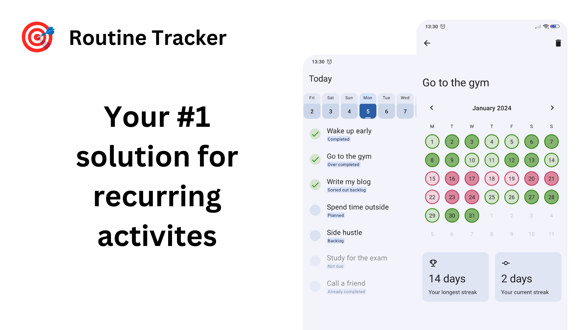
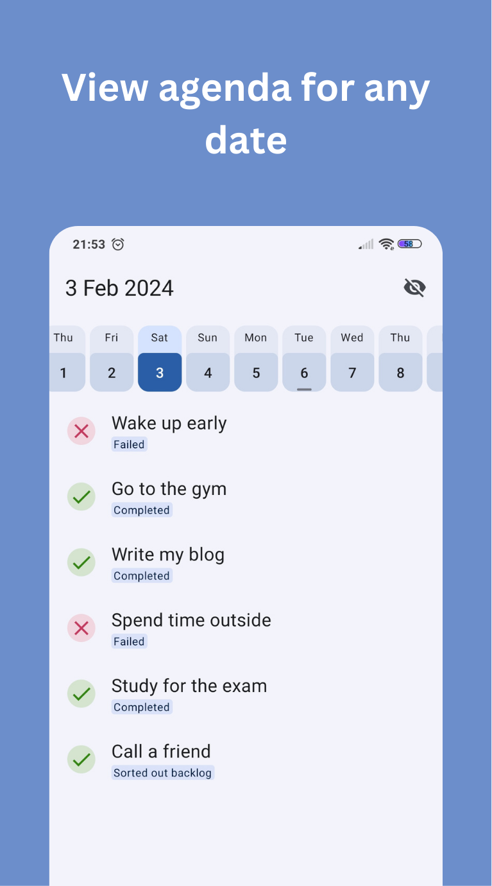
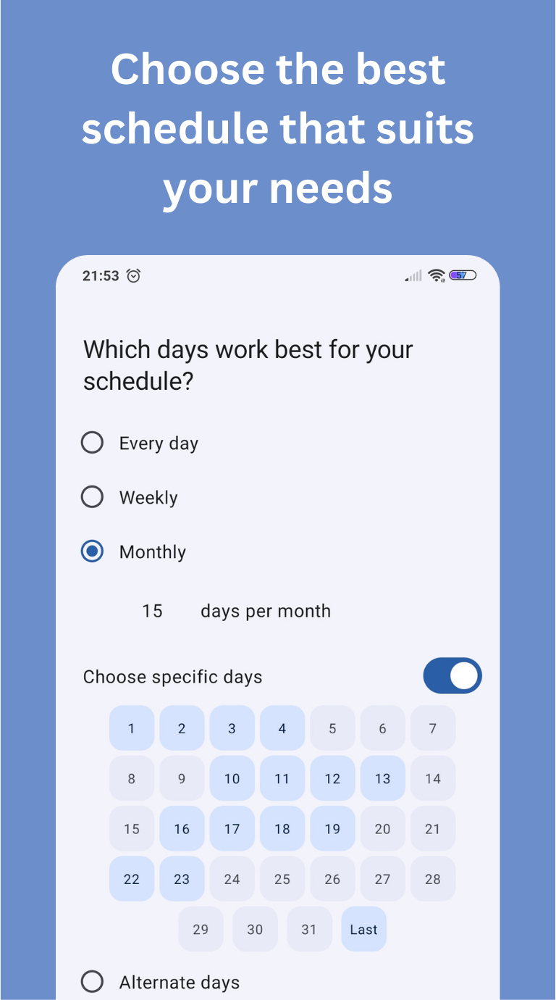
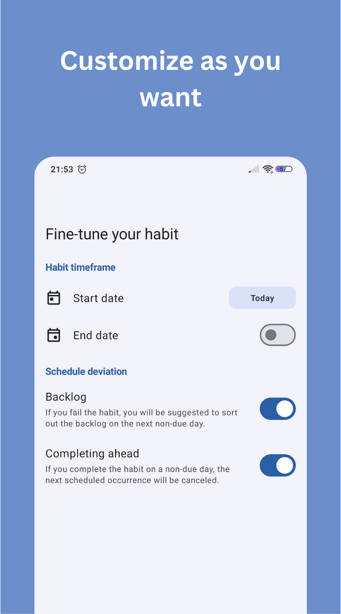

<h1 align="center" style="font-size:28px; line-height:1"><b>Routine Tracker</b></h1>

  

 

  

      

 

 
 

|                                                         |                                                         |                                                      |
|---------------------------------------------------------|---------------------------------------------------------|------------------------------------------------------|
|  |  |  |

Routine Tracker is a planner that aims to simplify managing activities that you need to perform consistently. It combines features of a planner calendar app and a habit tracker allowing you to keep all your activities in one place.

The motivation for this project is simple. I couldn't find any planner or habit tracker that estimates how long it will take you to achieve a goal based on your progress. So I decided to build it myself. I aim to develop a universal solution for planning and tracking your projects as well as scheduling your daily tasks and events. 

## Features

- **Flexible schedules.** The app supports daily, weekly, monthly, and alternate-day schedules. You're free to choose specific days or inform the app how many times you wish to complete the task within a period.
- **Adaptive schedule that changes automatically based on your progress.** When you fail to complete your routine, you’ll be suggested to sort out the backlog on the next non-due day. And vice versa, when you over-complete your routine, the next scheduled occurrence will be canceled. This behavior can be altered in the settings.
- **Adequate streaks.** Streaks do not only form out of multiple completions in a row. Non-due days are included in the streak as well. Your streak will remain unbroken as long as you complete the habit the planned number of times within a given period.
- **Plan ahead.** The routine calendar displays completions, streaks, and planning dates to help you visualize your progress and plan your future time effectively. View a clean and organized agenda for any date, eliminating visual clutter.
- **Modern UI.** Enjoy a visually appealing and modern interface, following the principles of the Material You design. The application supports both light and dark modes, landscape orientation, and dynamic color on Android versions 12 and later.
- **Completely free app with no limitations.** Track as many habits as you wish. Routine Tracker is entirely free and contains no ads or in-app purchases.
- **Works offline and respects your privacy.** Routine Tracker operates independently without needing an internet connection or online account registration. Your confidential data always remains on your device. Neither the developers nor any third parties can access your information.

## Get the app

You can install the app from the [GitHub releases](https://github.com/DanielRendox/RoutineTracker/releases) page or build it yourself by [cloning the project](https://docs.github.com/articles/cloning-a-repository) and launching it in the [Android Studio](https://developer.android.com/studio).

Please note that the SQLDelight plugin `v2.0.2` does not work well with the new Android Studio Koala. Since the project uses SQLDelight, this results in an internal error that disables syntax highlighting for project files. So if you have this plugin installed, you might want to disable it for smoother browsing. Alternatively, you can download an older version of Android Studio from the [download archives](https://developer.android.com/studio/archive).

## Tech stack

The app is built with modern Android technologies and is designed to follow the best practices.

It utilizes:

- Jetpack Compose for the user interface, with a single Activity and no Fragments
- Official Compose navigation library
- View model for business logic separation
- SQLDelight database for local data storage
- Kotlin coroutines and flow for asynchronous requests
- Koin for dependency injection
- JUnit 5 for unit testing
- [kotlinx-datetime](https://github.com/Kotlin/kotlinx-datetime) for working with dates
- A super convenient [Calendar](https://github.com/kizitonwose/Calendar) library for Android. (shoutout to [@kizitonwose](https://github.com/kizitonwose))

The app follows:

- MVVM pattern
- CLEAN architecture with both repository and use cases
- SOLID principles
- multi-module architecture as suggested in the [NowInAndroid modularization learning journey](https://github.com/android/nowinandroid/blob/main/docs/ModularizationLearningJourney.md). It involves convention plugins and version catalogs for managing dependencies across modules.

## Branching strategy
The project's branching strategy is simple. All the development work takes place in the `develop` branch whereas the `main` branch contains the code that is used in production. `feature` branches must be first merged into `develop`. Once the new features are implemented and tested, they are finally merged into `main` followed by the release of a new version of the app. When contributing to the project, please submit your pull requests to the `develop` branch.

## License
The project is licensed under the GPL, which means that you can freely build on top of it for commercial and non-commercial purposes alike. But should you choose to incorporate its code, you must open-source your project and apply the GPL license to it as well. Check out the [LICENSE](https://github.com/DanielRendox/RoutineTracker/blob/main/LICENSE) file for more details.
